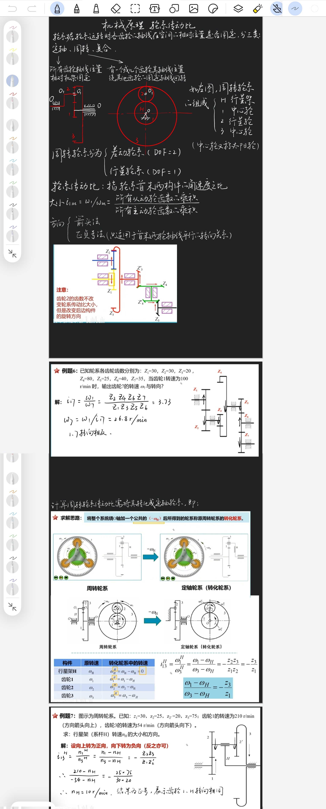

## W3（10/12–10/18）：核心公式 + 建模开练

- **提交人**：____________　**分工编号**：________　**状态**：____
- **本周所学（知识点）**
  - **电控组**：□ 电机与拖动：直流机械特性/起动调速、异步电机等效电路与转矩　□ 自控时域分析（一二阶响应/劳斯判据/稳态误差）　□ 能读 C 仿真内核 `.c`（主从/CCC/DCC）　□ Python 环境跑通　□ **吃透 `J·dω/dt = Te − B·ω − T_L` 与 PI**
  - **机械组**：✅️ 理论力学动量矩/动能定理　□ 材料力学扭转/扭矩图/圆轴应力与刚度　✅️ 机械原理轮系传动比　□ 机械设计轴的设计 + 联轴器选型　□ SolidWorks 装配体与干涉检查
- **学习证明**：___________
- **项目交付物**
  - 电控组：`J·dω/dt = Te − B·ω − T_L` 与 PI 的理解笔记
  - 机械组：CATIA 简化传动链（转子圆柱 + 联轴器 + 负载盘，能出质量属性）
- **验收物**
  - 电控组：`control_scheme.md` 公式逐行读笔记 / PI 理解说明（md）
  - 机械组：传动链模型 + 惯量测量值（**先切 MKS 单位再测**）
- **备注**：____________