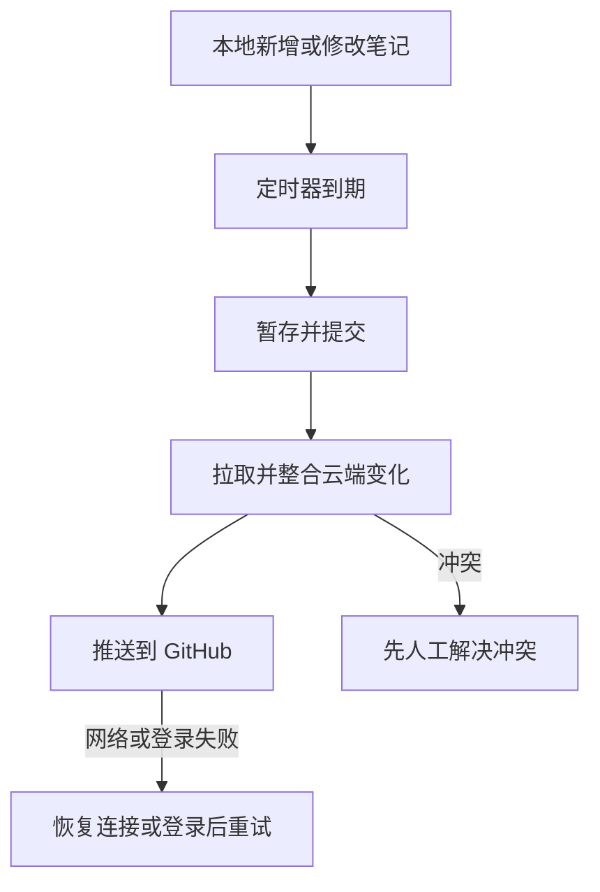

# 4. 配置 Obsidian Git 自动同步

## 安装与启动

在**独立笔记库**中进入“设置 → 社区插件 → 浏览”，搜索 **Git**，安装并启用；作者为 Vinzent，插件 ID 为 `obsidian-git`。如果社区插件未启用，先按 Obsidian 的提示启用。

已经关联 GitHub 的库，不要再执行“Initialize a new repo”。确认终端首次推送已成功。插件启动时找不到 Git，可在其 Advanced 设置中检查 Git 的路径；安装 Git 后可能需要重新启动 Obsidian。

## 六项主要设置：位置、含义和推荐值

以下按本次验证的 **Git 2.41.1** 名称整理。不同版本可能改名或调整分组，以安装版本的设置界面为准。

| 页面 / 分组 | 选项 | 推荐 | 意义 |
| --- | --- | --- | --- |
| Automatic | Auto commit-and-sync interval (minutes) | 5 | 每约 5 分钟尝试本地提交并同步；0 表示关闭 |
| Automatic | Use separate commit and push intervals | 关闭 | 提交与推送使用同一个周期；开启时可以分别定时 |
| Sync → Commit-and-sync | Push on commit-and-sync | 开启 | 同步操作会把提交上传；关闭时只保留本地提交及可选拉取 |
| Sync → Commit-and-sync | Pull on commit-and-sync | 开启 | 同步时整合云端更新，再推送，适合多设备或协作 |
| Sync → Pull | Pull on startup | 开启 | 打开 Obsidian 时拉取云端最新提交 |
| Automatic | Auto commit-and-sync only staged files | 关闭 | 允许新笔记也被自动纳入；开启后仅处理手动暂存的内容 |

另外，将 **Specify custom commit message on auto commit-and-sync** 关闭，避免每次弹出填写提交说明的对话框；其他定时器不需要同时启用。

前两项在 Automatic，**推送、拉取和启动时拉取在 Sync 页面**。找不到时不要只在同一页上下滚动。

参考：[设置定义](https://github.com/Vinzent03/obsidian-git/blob/master/src/setting/settings.ts)、[自动同步说明](https://publish.obsidian.md/git-doc/Features)。

## 提交、推送和拉取有什么区别

- **Commit（提交）**：把修改记录为本地版本，没有上传。
- **Push（推送）**：上传本地提交到 GitHub。
- **Pull（拉取）**：取得并整合 GitHub 上的新提交。

只有保存文件，或者只看到“commit 成功”，都不能证明文件已经到 GitHub。

## 用一次手动操作确认插件可工作

打开命令面板，选择 **Git: Commit-and-sync**。这是配置验证，不是后面自动化验收的一部分。如果弹出选择远程仓库的窗口，点击 **origin**。

`origin` 是已配置远程连接的常见名称，不是账号，也不是要创建的新仓库。它应指向你自己的 GitHub 地址。发现地址不对时先取消并检查，不填写原作者的仓库地址。

记录并处理弹出的错误。之后再创建一份新的测试笔记，用定时器独立验收。

## 必须知道的运行条件

自动同步时需 Obsidian 正在运行并打开正确的库、Git 可调用、远程登录有效且网络可用。插件不在 Obsidian 关闭后继续后台运行；重新打开后，可能补执行已经到期的定时同步。它不是每输入一个字就上传。

不要把“每五分钟”理解为无条件严格在第 300 秒完成；网络、启动、任务耗时和弹窗可能延迟。测试失败时分层排查，不把等待更多时间当作唯一办法。

如果要在 Obsidian 完全关闭时也上传，需要另行部署操作系统后台任务，不属于本包默认配置。手机上的 Git 插件实现有不同限制，本次桌面验证不能替代手机验证。

多个同步服务同时修改同一库可能产生干扰。若决定以 Git 为主要同步方法，应单独规划其他同步服务，避免未经设计的重复同步。[Obsidian 同步说明](https://help.obsidian.md/sync-notes)
