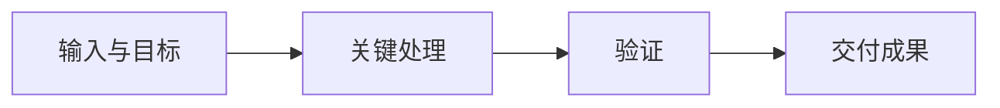

# 项目名称

> [!abstract] 一分钟了解
> 项目要解决什么问题；最终做成什么；谁可以怎样使用它。

## 背景与目标

说明需求、必要背景和主要约束，让没参加对话的读者理解为什么做。

## 成果与使用方式

列出主要交付物和入口，说明实际完成程度及最短使用步骤。

## 工作流

替换为本项目真实流程，说明输入如何成为成果。按需插入已存在的成品图片并写图注。

## 关键决策

| 决策 | 原因 | 影响或取舍 |
| --- | --- | --- |
| 核心选择 | 为什么这样做 | 对使用者意味着什么 |

## 验证与限制

描述实际做过的验证及结果，区分未验证部分。保留影响使用的重要限制。

## 可复用经验与下一步

保留最有用的经验、待办和后续方向；没有待办时不制造待办。

## 参考与产物

链接必要文件和实际参考来源；若对话链接不可用则说明来源为本次对话。

> [!note]- 复现细节（按需）
> 将确实必要的配置、命令与排错细节放在这里，避免打断正文。
