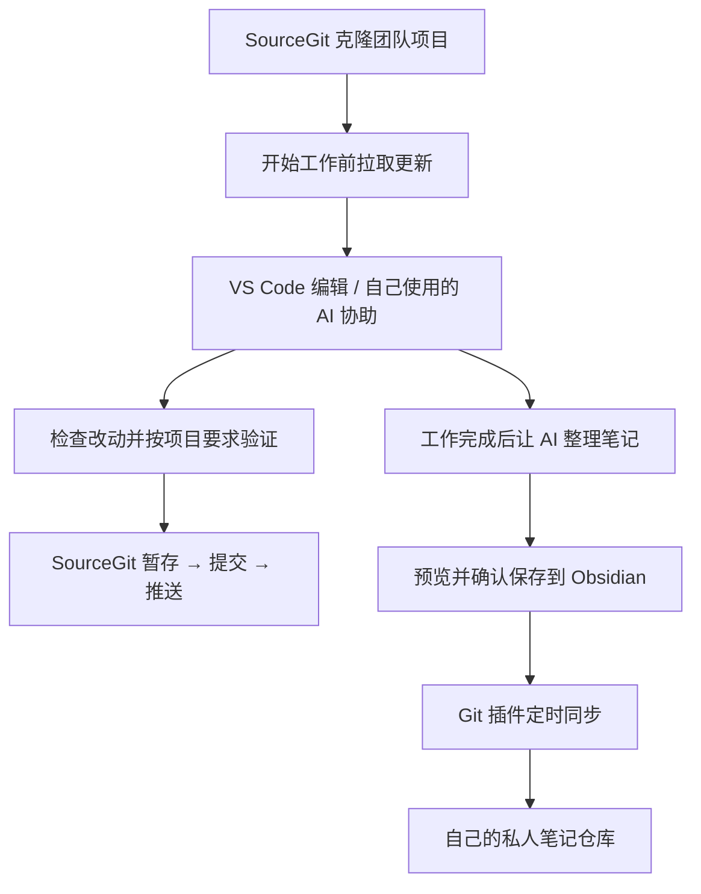
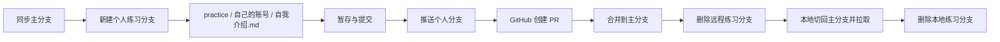

# 新队员上手指南：Git 文件管理与 AI 工作流

> [!abstract] 先完成这两件事
> **项目协作：**用 SourceGit 下载项目、查看改动、提交并上传。
> **工作记录：**让 AI 整理项目笔记，保存到 Obsidian，再自动同步到自己的私人 GitHub 仓库。

适用于 Windows。本文按图形界面操作编写，软件下载入口于 2026-10-06 核对，本版于 2026-10-07 更新。按钮名称可能随版本变化，可对照括号里的英文。第 4 节用 Git-Test 完整练习“分支 → 拉取请求 → 合并”，已有队友走通；正式项目的审核框架仍在建设中，具体协作方式按负责人要求。AI 可用自己习惯的工具，不要求所有人安装 Codex。

## 1. 每个工具是做什么的？

| 工具 | 你会用它做什么 |
| --- | --- |
| Git | 在电脑上记录文件版本，是 SourceGit 和同步插件需要的底层工具 |
| SourceGit | 点击按钮下载项目、查看改动、提交、上传 |
| GitHub | 保存云端仓库，让队友获取项目，也备份个人笔记 |
| VS Code | 打开项目文件夹，编辑代码和文档 |
| 自己使用的 AI 工具 | 协助理解代码、修改、排错和整理工作记录；是否能直接编辑本地文件取决于工具能力 |
| Obsidian | 阅读和编辑自己的项目笔记 |
| Obsidian Git 插件 | 定时把笔记修改提交并上传到 GitHub |

**SourceGit、VS Code 和能访问本地文件的 AI 工具，打开同一份项目即可。**网页聊天工具可粘贴必要内容或上传允许分享的文件。代码项目和笔记库分别放在独立文件夹中，建议平级放置。



## 2. 安装软件和插件

### 软件：建议按下面的顺序准备

| 软件 / 账号 | 官方入口 | 安装后检查 |
| --- | --- | --- |
| Git for Windows | [官方下载](https://git-scm.com/install/windows) | 完整安装后重开 SourceGit；安装时保留 Git Credential Manager，允许第三方软件调用 Git |
| SourceGit | [官网](https://sourcegit-scm.github.io/) · [官方发布包](https://github.com/sourcegit-scm/sourcegit/releases/latest) | 下载对应 Windows 架构的包，解压并运行，能识别 Git |
| VS Code | [官方下载](https://code.visualstudio.com/Download) | 能通过“文件 → 打开文件夹”打开项目 |
| GitHub 账号 | [注册入口](https://github.com/signup) | 使用自己的账号，并接受负责人的仓库邀请 |
| Obsidian | [官方下载](https://obsidian.md/download) | 能将本地文件夹打开为库 |
| AI 工具（自选，Codex 为一种选择） | Codex：[OpenAI Windows 安装指南](https://learn.chatgpt.com/docs/windows/windows-app) · [官方商店入口](https://apps.microsoft.com/detail/9PLM9XGG6VKS)；其他工具从各自官网获取 | 使用自己的账号，按第 7 节选择适合自己的笔记路线 |

SourceGit 需要先安装 Git。[官方说明](https://github.com/sourcegit-scm/sourcegit) 项目另需的编译器、烧录工具等，向负责人索要项目环境说明。

### 插件：先装需要的，其他以后再加

| 组件 | 安装位置 | 用途 |
| --- | --- | --- |
| Git（作者 Vinzent，ID：obsidian-git） | Obsidian → 设置 → 社区插件 → 浏览，搜索并安装、启用 | 笔记自动同步；[作者安装指南](https://publish.obsidian.md/git-doc/Installation) |
| 中文简体语言包（可选） | VS Code → 扩展，搜索 Chinese | 中文界面；[Microsoft 官方扩展](https://marketplace.visualstudio.com/items?itemName=MS-CEINTL.vscode-language-pack-zh-hans) |
| Codex 扩展（可选） | VS Code → 扩展 | 习惯在编辑器中用 AI 时再装；[OpenAI 官方扩展](https://marketplace.visualstudio.com/items?itemName=openai.chatgpt) |
| AI 项目笔记规则 / 技能 | 按第 7 节配置到自己的 AI 工具 | Codex 可用分享包；其他 AI 可用通用规则。它不是 Obsidian 插件 |

## 3. 第一次打开 SourceGit

1. 打开**偏好设置（Preferences）→ Git**。
2. 检查“安装路径”是否识别到 Git，且能显示版本。若为空，选择安装位置中的 `git.exe`，常见位置为 `C:\Program Files\Git\cmd\git.exe`，以自己的安装目录为准。
3. 填写“用户名”和“邮箱”，按下方团队统一规则配置。这两项记录谁做了修改，**不是登录密码**。
4. 如需中文界面，在偏好设置的语言选项中选择简体中文。

设置项可对照 [SourceGit 偏好设置界面](https://github.com/sourcegit-scm/sourcegit/blob/master/src/Views/Preferences.axaml)。首次下载或推送时，可能弹出 GitHub 登录/授权窗口，用自己的账号完成。若私人仓库看不到，先检查邀请是否接受、账号是否正确。[GitHub 登录凭据说明](https://docs.github.com/en/get-started/git-basics/caching-your-github-credentials-in-git)

### 团队统一的用户名和邮箱

**可以自定义的协作用户名，统一使用自己的 GitHub 用户名；可以选择的协作邮箱，统一使用 GitHub 账户中已验证的邮箱。**例如 GitHub 用户名是 `team-member`，SourceGit 的 Git 用户名就填 `team-member`，分支和自我介绍也用它标识自己。

| 位置 | 怎么保持一致 |
| --- | --- |
| GitHub | 用户名看个人主页地址中的账号名，不是可另外填写的显示姓名；邮箱在头像 → Settings → Emails 查看并验证 |
| SourceGit → 偏好设置 → Git | 用户名填 GitHub 用户名，邮箱填上述已验证邮箱 |
| SourceGit 的仓库单独配置 | 若已有不同的作者姓名或邮箱设置，改成相同值，避免它覆盖全局设置 |
| VS Code、AI 工具、Obsidian Git | 使用同一仓库时沿用 Git 作者设置；工具额外允许设置协作昵称时也用 GitHub 用户名 |
| 其他软件的登录账号 | 允许自选时保持一致；学校/组织账号、第三方登录或不可修改的账号按平台要求，不必强行改成 GitHub 账号 |

GitHub 用提交邮箱关联账户，姓名按团队约定保持一致即可。[GitHub 提交邮箱说明](https://docs.github.com/en/account-and-profile/how-tos/email-preferences/setting-your-commit-email-address) 提交中的邮箱会随版本记录保存；如要隐藏真实邮箱，可统一使用 GitHub 在 Settings → Emails 提供的 **noreply 地址**作为 Git 提交邮箱，并告知负责人。网页和本地提交的邮箱可能因此不同，但都属于自己的同一账户。若遇到隐私邮箱保护导致推送被阻止，也优先这样处理。

## 4. 把团队项目下载到电脑并关联 GitHub

先向负责人要：**仓库地址、访问权限、使用哪个分支，以及项目如何运行或验证。**

**测试用仓库地址**：[Git-Test](https://github.com/Zhemeng123/Git-Test.git) （私人仓库需要先让负责人添加你为该仓库的协作者）

1. 在 GitHub 打开项目仓库，点击 **Code → HTTPS**，复制地址。
2. 在 SourceGit 首页选择**克隆远程仓库（Clone）**。
3. 在“远程仓库”中粘贴地址；“父级目录”选择存放项目的地方；“本地仓库名”填写文件夹名称。
4. 点击确认，等待完成。如果项目使用子模块，按负责人要求勾选初始化子模块。
5. 打开克隆后的仓库，确认远程列表中有 **origin**；它就是本地与 GitHub 的连接。
6. 查看当前分支是否为负责人指定的分支。若需要切换，先确认没有未提交改动，在分支列表中对目标分支使用“检出（Checkout）”；不确定时让负责人带你操作。
7. 在 VS Code 中打开**克隆得到的文件夹**，即可编辑。

**克隆会同时建立远程连接，完成后不用再手动“关联 GitHub”。**已经克隆过的项目，在 SourceGit 打开现有本地仓库即可。下载 ZIP 通常只有文件，不适合后续版本同步。[GitHub 克隆说明](https://docs.github.com/en/repositories/creating-and-managing-repositories/cloning-a-repository) · [SourceGit 克隆界面](https://github.com/sourcegit-scm/sourcegit/blob/master/src/Views/Clone.axaml)

### 上手练习：在 practice 中新增自我介绍

**目标：从主分支新建自己的分支，新增自我介绍，推送后在 GitHub 创建拉取请求（PR），合并回主分支，再删除练习分支。**PR 在这里就是“请把我这个分支的修改合到主分支”。这项练习不要求先建立正式审核制度。

先确认已接受 Git-Test 的协作者邀请。以下主分支以 `main` 为例；如果仓库实际使用其他名称，以负责人指定的主分支替换。示例账号为 `team-member`，全部换成自己的 GitHub 用户名。

1. **同步主分支。**在 SourceGit 打开 Git-Test，确认本地没有未提交改动；检出 `main`，点击 Pull，从 origin 的主分支拉取最新内容。
2. **创建自己的分支。**右键主分支，选择“新建分支”；名称填 `practice/team-member-intro`，确认基于最新主分支，勾选“完成后切换到新分支”。创建后检查当前分支名称，不要直接在 main 写练习。
3. **新建自我介绍。**在 VS Code 的文件树中新建 `practice/team-member/自我介绍.md`。每个人在 practice 下用自己的账号建子文件夹，避免多人新增同一个文件产生冲突。填入下面的内容并保存，只写愿意向团队分享的信息。

```markdown
# 自我介绍

- GitHub 用户名：team-member
- 团队称呼：小明
- 所属方向：电控
- 当前学习内容：Git 文件管理与 AI 项目笔记
- 希望参与的任务：整理传感器资料
- 本次练习：新建分支、提交、推送、创建 PR、合并和清理分支
```

4. **暂存并提交。**回到 SourceGit 的本地更改，查看自我介绍文件的差异；只暂存这个文件，提交说明写“新增 team-member 自我介绍”，点击 Commit。
5. **推送自己的分支。**点击 Push，远程选 origin，本地分支和远程分支均为 `practice/team-member-intro`。第一次推送若需要选择“新建”远程分支，使用同名分支，并勾选跟踪远程分支。不要选 main，也不要启用强制推送。
6. **在 GitHub 创建 PR。**打开 Git-Test，点击 **Compare & pull request**；没有提示条时用 **Pull requests → New pull request**。确认 **base = main**（合到哪里），**compare = practice/team-member-intro**（自己的改动从哪里来）。检查 Files changed 只有自己的文件，标题写“新增 team-member 自我介绍”，说明“完成新队员 Git 入门练习”，点击 Create pull request。[创建 PR 官方说明](https://docs.github.com/en/pull-requests/how-tos/create-pull-requests/creating-a-pull-request)
7. **合并回主分支。**在练习允许且自己有权限时，点击 **Merge pull request → Confirm merge**；没有按钮、提示冲突或需他人确认时，把 PR 链接交给负责人处理。练习优先采用 Create a merge commit，方便后面正常删除本地分支；若仓库只允许其他方式，以负责人要求为准。看到 **Merged** 后，在 main 查看自己的文件。[合并 PR 官方说明](https://docs.github.com/en/pull-requests/how-tos/merge-and-close-pull-requests/merging-a-pull-request)
8. **清理远程和本地练习分支。**合并成功后，在 GitHub PR 页面点击 **Delete branch**，删除自己的远程练习分支；若已自动删除则跳过。回 SourceGit 检出 main，点击 Pull，确认本地也有自我介绍，然后在**本地分支列表**右键自己的练习分支 → 删除。仅删除已合并的自己的练习分支，保留 main；若提示未合并，先找负责人核对，不勾选强制删除。GitHub 删除远程分支不会自动删除本地分支。



**验收：**主分支有自己的自我介绍、PR 显示 Merged、本地当前为主分支，自己的远程和本地练习分支均已清理。完成后可把 PR 链接发给负责人确认。

## 5. 日常操作：照着这六步走

| 顺序 | 在哪里操作 | 怎么做 |
| --- | --- | --- |
| ① 拉取更新 | SourceGit 顶部 **Pull**（拉回/拉取） | 开工前，在本地没有未提交改动时，确认 origin 和分支后拉取最新版本 |
| ② 修改文件 | VS Code / 自己使用的 AI | 完成当前任务，保存文件；让 AI 明确说明改了什么和如何验证 |
| ③ 检查改动 | SourceGit **本地更改 / Local Changes** | 点击文件查看前后差异，确认没有误删、无关文件或账号密钥；按项目说明运行或验证 |
| ④ 暂存 | **未暂存 / Unstaged** 列表 | 选中本次要提交的文件，右键“暂存”或点击“暂存选中”；文件会移到“已暂存” |
| ⑤ 提交 | 提交信息区域 | 写清楚做了什么，例如“补充传感器接线说明”，点击 **Commit（提交）** |
| ⑥ 推送 | SourceGit 顶部 **Push（推送）** | 远程选 origin，本地与远程分支按负责人要求对应，确认后上传；完成后在 GitHub 核对文件 |

点错暂存时，可以把文件**从暂存区移除**，文件修改仍保留。每次提交前只选择本次需要的文件。操作可对照 [SourceGit 工作区界面](https://github.com/sourcegit-scm/sourcegit/blob/master/src/Views/WorkingCopy.axaml)。

> [!tip] 记住三个区别
> **保存文件：**写到电脑里。**Commit：**在电脑里留下一个版本。**Push：**把这个版本传到 GitHub。完成推送，队友才可以获取。

若出现冲突、推送被拒绝，或开工前还有未提交修改，先保留现场并找负责人处理。不要为了“让按钮成功”勾选强制推送、重置或放弃改动。同一文件多人修改前，先沟通各自负责的部分。

## 6. 建立自己的私人笔记仓库（推荐）

**目前每位队员新建自己的私人笔记仓库。**它与团队代码项目分开，下面的方法适合从零开始。

1. 在 GitHub 点击 **New repository**，填写名称，例如 `AI-Project-Notes`。
2. 选择 **Private（私人）**，勾选创建 README，再点击创建仓库。
3. 用前面的 SourceGit **Clone** 操作，把它下载到独立目录，例如 `D:\TeamWork\AI项目知识库`。不要放进代码项目内部。
4. 在 Obsidian 选择**打开文件夹作为仓库/库**，打开这个克隆后的文件夹。
5. 在库里新建 `AI 项目笔记` 文件夹，用来放之后生成的笔记。
6. 用 VS Code 在库的根目录新建或打开 `.gitignore`，添加下面一行，已有规则保留：

```text
.obsidian/
```

这行让每个人的 Obsidian 设置留在本机；各自安装插件并配置即可。首次准备完成后，在 SourceGit 中按“检查 → 暂存 → 提交 → 推送”上传 `.gitignore` 和需要的笔记。

已有本地笔记但尚未关联云端时，也可先克隆新仓库，再复制需要的笔记和附件，检查内容无误后提交、推送；确认迁移成功前保留原文件。

## 7. 让 AI 帮你记录，再让插件自动上传

### 获取整合包并解压

向负责人领取 **新队员Git与AI笔记工作流-完整分享包-2026-10-07.zip**，在资源管理器中右键 → “全部提取”。一份 ZIP 已包含最新版上手指南、笔记技能、模板、配置、安装脚本和排错资料，不需要另外领取附件，也不需要访问原作者的私人笔记仓库。

解压后先阅读 `README.md`，再打开 `新队员上手指南.md`。所有安装资源都在解压目录内；无需将整个分享包放进自己的代码仓库或笔记库。

安装脚本面向 Codex；其他 AI 按路线 B 或 C 配置。获取压缩包不等于技能已安装，完成后仍需测试。

### 路线 A：使用 Codex，安装本地技能

1. 先按第 6 节建好独立笔记库，并在 Obsidian 中打开一次；记下自己的**库根目录**，不是 `AI 项目笔记` 子目录。
2. 在资源管理器中右键 ZIP → “全部提取”，打开解压目录，确认能看到 `README.md`、`install.ps1` 和 `obsidian-project-notes` 文件夹。只看到 ZIP 或只打开 SKILL.md 都不算安装。
3. 在 Codex 打开这个解压目录，粘贴以下请求，把路径改成自己的：

> 请阅读 README.md，帮我安装或升级 Obsidian 项目笔记工作流。我的库根目录是「填写自己的本地路径」，笔记放在“AI 项目笔记”。请先核对当前 Codex 实际加载技能的目录；v2 安装脚本使用旧的 .codex/skills 路径，如果当前版本不加载该位置，请按当前版本支持的目录安装，避免重复副本。保留已有全局指令和个人配置，填好已安装技能的 settings.json。由 Obsidian Git 插件负责同步，不替它自动推送。最后报告实际安装路径、实际笔记路径和如何验证。

4. 按系统提示批准准确的文件写入；安装已有旧版时走升级，保留个人配置。包里的 `settings.json` 初始库路径为空，必须填成自己电脑的路径；复制别人的配置不能直接沿用别人的 E 盘路径。
5. 新开 Codex 聊天，问：“请说明我的项目收尾规则、使用的笔记技能、实际库路径和笔记保存目录。”应能说明：项目完成询问一次，可预览、保存或跳过；笔记确认后才写入。找不到技能时重启后再检查，不把“已经复制文件”当成成功。
6. 做下面的统一笔记测试，Obsidian 能读到文件后再检查自动同步。

当前官方技能说明列出的用户技能目录是 `用户目录/.agents/skills`；本包原来在本机 `.codex/skills` 环境验证过。版本可能不同，以实际加载和新聊天测试为准。[Codex 技能官方说明](https://learn.chatgpt.com/docs/build-skills)

### 路线 B：使用其他能访问本地文件的 AI 助手

把分享包中的 `obsidian-project-notes/SKILL.md`、`note-template.md` 和下面的通用规则交给自己的助手，告诉它库根目录与笔记子目录。让它按**该产品支持的规则或技能配置方式**安装，并保留已有配置；没有确认兼容时，不运行 Codex 的 install.ps1，也不默认它识别 AGENTS.md 或 settings.json。若产品没有持久规则入口，每次新聊天粘贴通用规则即可。

先让它回答“是否能读写这个本地库、规则会在哪些聊天生效”，再测试写入。技能是写作规则，能否自动保存还取决于工具权限；未能写入时必须明确说未保存，并提供 Markdown。

### 路线 C：使用网页聊天或不能写本地文件的 AI

把通用规则放到该产品可用的自定义指令/项目说明中；没有该入口时，每次开工粘贴一次。收尾时让它输出 Markdown，自己在 Obsidian 新建笔记并粘贴。图片需一并保存到库内附件目录，再引用；Obsidian Git 仍可自动同步这些本地笔记。

> [!tip] 可直接复制的通用规则
> 每次有实质内容的项目完成或我明确说“项目结束”时，询问一次：“要把这次项目整理成图文笔记，保存到 Obsidian 吗？”选项为“生成并保存”“先给我预览”“这次不用”。不要每轮重复问，跳过后不催问。先完成项目工作再整理。
>
> 笔记用中文，面向没参加对话的人，精炼记录背景、目标、最终成果、操作流程、关键决策、遇到的问题及解决方法、验证结果、限制和下一步。术语第一次出现要解释，使用 Mermaid 流程图；有价值且可使用的真实图片才嵌入，不虚构截图、历史或验证结论，不记录密码和密钥。
>
> 我选择预览时先展示，确认后才保存。能访问本地文件时，保存到我指定的独立 Obsidian 库的“AI 项目笔记/年份/日期-项目名称.md”，避免覆盖同名内容，附件放库内并使用相对链接。不能访问本地时输出可复制的 Markdown，并明确告诉我需要手动保存。不要声称监听关闭窗口，也不要承诺规则自动适用于其他产品或所有已有聊天。

**统一笔记测试例子：**做完第 4 节练习后，告诉自己的 AI：“我完成了 Git-Test 自我介绍练习，请根据本次实际过程生成图文项目笔记，先给我预览。我的笔记库根目录是……，笔记子目录是 AI 项目笔记。若无法直接保存，请提供完整 Markdown。”提供实际文件路径、PR 链接、结果和遇到的问题；没有访问实际操作记录的 AI 不能自行认定练习成功。

预览满意后，能写本地的助手经确认保存；其他工具由自己粘贴入库。开启新聊天或切换 AI 工具后，再检查规则是否仍生效；没有主动询问时，可以直接说“项目结束了，请按笔记规则整理”。

更换库路径时，更新自己 AI 工具实际使用的规则或配置；Codex 更新**已安装技能的配置**。只修改分享包副本不会自动改变安装后的路径。[Codex 指令配置说明](https://learn.chatgpt.com/docs/agent-configuration/agents-md)

### 开启笔记自动同步

在 Obsidian 的 Git 插件设置中配置：

| 设置位置 | 选项 | 设置值 |
| --- | --- | --- |
| Automatic | Auto commit-and-sync interval (minutes) | 5，约每五分钟同步一次 |
| Automatic | Use separate commit and push intervals | 关闭 |
| Automatic | Auto commit-and-sync only staged files | 关闭，让新笔记也能自动提交 |
| Automatic | Specify custom commit message on auto commit-and-sync | 关闭，避免等待输入 |
| Sync → Commit-and-sync | Push on commit-and-sync | 开启 |
| Sync → Commit-and-sync | Pull on commit-and-sync | 开启 |
| Sync → Pull | Pull on startup | 开启 |

这些名称和位置在 **Obsidian Git 插件 2.41.1** 中验证过。后三项在 **Sync**，不是 Automatic。弹出远程选择框时，选自己笔记仓库的 **origin**。[插件功能说明](https://publish.obsidian.md/git-doc/Features)

**保持 Obsidian 打开正确的库，定时同步才会运行。**这套自动同步用于个人笔记库；团队代码修改仍由自己检查并在 SourceGit 提交、推送。AI 负责整理，本地保存由有权限的助手或自己完成，上传由插件负责；三个步骤分别验收。

## 8. 五分钟验收与常见问题

完成下面几项，就能开始使用：

- [ ] Git 作者用户名与 GitHub 用户名一致，提交邮箱按第 3 节配置。
- [ ] SourceGit、VS Code 能打开同一份团队项目，自己选用的 AI 能获得必要内容。
- [ ] 第 4 节练习完成：主分支有自我介绍，PR 为 Merged，个人练习分支已清理。
- [ ] 已走通自己的 AI 笔记路线，能确认规则是否加载、由谁保存；Obsidian 能读到笔记。
- [ ] 新建“自动同步测试”笔记，写入一段独特文字并记下时间。
- [ ] 保持 Obsidian 打开，约五分钟内不手动提交或推送；然后在 GitHub 打开测试笔记，确认文字一致。

| 遇到的情况 | 先这样检查 |
| --- | --- |
| SourceGit 找不到 Git | Git 是否完整安装；在偏好设置 → Git 检查安装路径，重开软件 |
| 提示作者身份未设置 | 在偏好设置 → Git 填好用户名和邮箱 |
| 私人仓库打不开 / Repository not found | 账号是否正确，邀请是否接受，地址和权限是否正确 |
| 提交了但 GitHub 没变化 | 是否还没点 Push；GitHub 是否正在查看正确的仓库和分支 |
| 推送拒绝或出现冲突 | 保留现有修改和报错，找负责人一起处理，先不强推 |
| 五分钟后新笔记没上传 | 是否打开正确的库、插件已启用、间隔为 5、only staged 关闭，是否有待确认弹窗 |
| 没拿到安装文件 | 向负责人领取完整 ZIP 并全部解压；文件应与 README.md 放在同一个解压目录中 |
| AI 说装了技能但新聊天找不到 | 核对当前工具支持的技能目录和规则入口，检查是否重启或新开聊天；其他 AI 不默认兼容 Codex 安装脚本 |
| PR 的自我介绍发生冲突 | 是否多人用了同一个 practice/自我介绍.md；每人放在 practice/自己的用户名/ 下 |
| Connection was reset / 超时 | 检查网络、代理和登录；云端查询失败时先记为“尚未验证” |
| 笔记改动出现在代码仓库 | 检查笔记库是否误放在项目内部，迁出后更新技能保存路径 |

求助时提供**错误截图、当前仓库与分支、软件版本、刚才点了哪一步**，不用先学一串命令。截图和笔记中不要包含密码、访问令牌或私钥。

> [!success] 之后每次重复这条路线
> **开工拉取 → 修改并验证 → 检查与提交 → 推送 → 工作收尾生成笔记 → 自动同步到自己的笔记仓库。**
